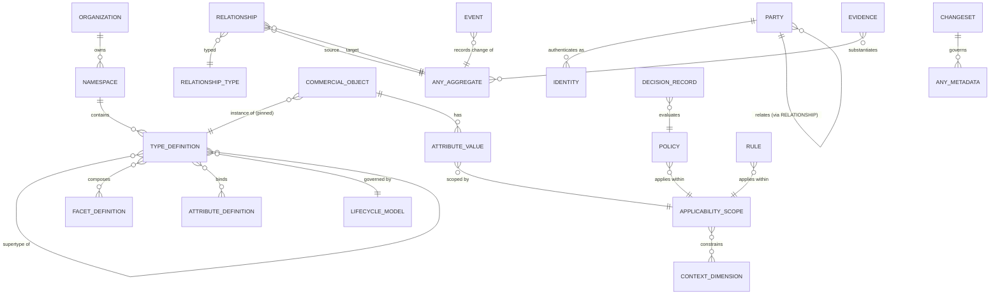

# CIC-003-001 — Data Constitution

## 1. Model layers

| Layer | Artifact | Normative source |
|-------|----------|------------------|
| Conceptual | Kernel concept graph (§2) | This artifact |
| Logical | Aggregates, entities, VOs per domain | `DOM-*.yaml` (aggregates/entities/valueObjects) |
| Physical | Tables, indexes, partitions per context | `DOM-*.yaml` persistenceModel + §4–§7 here |
| Graph | Property graph projection | CIC-004 (Knowledge Graph Constitution) + §3 here |

## 2. Conceptual model (kernel)



## 3. Graph model

Every aggregate is a vertex labeled with its kernel kind and, for CommercialObjects, every
type in its linearized supertype chain (`:CommercialObject:Product:MobileHandset`). Every
Relationship is an edge labeled with its RelationshipType name. Edge properties: `relId, validFrom,
validTo, scopeDigest, attributes`. Vertex properties are limited to identity, type, lifecycle state,
and attributes flagged `graphIndexed` in the ontology. The graph is a **projection** (never the
system of record) rebuilt from events (CR-003-001-04).

## 4. Standard tables (every bounded context schema)

```sql
CREATE TABLE event_store (
  tenant_id       uuid        NOT NULL,
  aggregate_type  text        NOT NULL,
  aggregate_id    char(26)    NOT NULL,
  sequence        bigint      NOT NULL,          -- per-aggregate, gapless, starts at 1
  event_id        char(26)    NOT NULL,          -- ULID
  event_type      text        NOT NULL,          -- ucos.<ctx>.<agg>.<event>.v<N>
  schema_version  text        NOT NULL,
  occurred_at     timestamptz NOT NULL,
  recorded_at     timestamptz NOT NULL DEFAULT now(),
  correlation_id  char(26)    NOT NULL,
  causation_id    char(26),
  principal       text        NOT NULL,          -- URN of acting party/agent
  payload         jsonb       NOT NULL,
  payload_enc_key text,                          -- key id when payload contains encrypted fields (crypto-shred)
  PRIMARY KEY (tenant_id, aggregate_id, sequence, recorded_at)
) PARTITION BY RANGE (recorded_at);
CREATE UNIQUE INDEX ON event_store (event_id, recorded_at);

CREATE TABLE outbox (
  id            bigserial PRIMARY KEY,
  event_id      char(26) NOT NULL UNIQUE,
  topic         text     NOT NULL,
  partition_key text     NOT NULL,             -- tenant_id:aggregate_id
  envelope      jsonb    NOT NULL,             -- full CloudEvent
  created_at    timestamptz NOT NULL DEFAULT now(),
  published_at  timestamptz
);
CREATE INDEX ON outbox (created_at) WHERE published_at IS NULL;

CREATE TABLE snapshots (
  tenant_id uuid, aggregate_id char(26), sequence bigint, state jsonb, taken_at timestamptz,
  PRIMARY KEY (tenant_id, aggregate_id, sequence)
);

CREATE TABLE processed_messages (       -- consumer idempotency
  consumer text, event_id char(26), processed_at timestamptz,
  PRIMARY KEY (consumer, event_id)
);
```

Persistence styles: a context MAY choose **event-sourced** (event_store is the source of truth,
state tables are projections) or **state-stored + outbox** (state tables are truth, events written in
the same transaction to event_store and outbox). Both MUST produce identical published events.
Kernel aggregates (K-1) and all financial aggregates (BIL, REV, STL, ACC) MUST be event-sourced.

## 5. Tenancy and row security

- Every table holding tenant data has `tenant_id` as the first PK column.
- PostgreSQL RLS policy `tenant_id = current_setting('ucos.tenant_id')::uuid` on every table holding tenant
  data; service roles do not have `BYPASSRLS`. Platform-wide jobs use a dedicated audited role.
- Platform bookkeeping tables without tenant data (`outbox`, `processed_messages`, and platform-wide registries
  such as published packs and event types) carry no `tenant_id`. They are governed by role grants instead: a
  service role may only `INSERT` into its `outbox`, and only the dedicated relay role may read or update it
  (AMD-0002, from RI AR-0001).
- Very large tenants MAY be placed in a dedicated database (cell) — routing via the tenant directory (DOM-RTM).

## 6. Index strategy

1. Every query in a domain's `queries` list MUST be served by an index (verified by `EXPLAIN` tests, no seq scan on tables > 10⁵ rows).
2. JSONB attribute values: GIN `jsonb_path_ops` on base values; attributes flagged `filterable` get
   generated columns + B-tree indexes created by the ontology-driven index planner (DDL generated
   from EffectiveSchema, applied by migration job, never hand-written).
3. Temporal validity: GiST on `tstzrange(valid_from, valid_to)` + exclusion constraints for non-overlap.
4. Full-text and faceted search are served only by the search projection (DOM-SRC), never by OLTP.

## 7. Partitioning strategy

| Data class | Strategy |
|------------|----------|
| Aggregate state | HASH(tenant_id) 64 partitions; split to cell DB above 2 TB per tenant |
| Event store, decision records, audit | RANGE(recorded_at) monthly; older partitions detached to archive |
| Usage records (metered) | RANGE(day) × HASH(tenant_id) 16 |
| Scoped facts (prices, contextual values) | HASH(tenant_id); sub-partition by fact kind when > 10⁹ rows |
| Kafka topics | key = `tenant_id:aggregate_id`; partitions = 2 × peak consumer parallelism, min 12 |

## 8. Retention and archival

| Data | Hot | Warm (archive store, Parquet on object storage) | Delete |
|------|-----|-----------------------------------------------|--------|
| Events (non-financial) | 24 months | +5 years | After 7 years unless legal hold |
| Events (financial, tax) | 24 months | per jurisdiction policy `retention.financial` (min 10 years) | Policy-driven |
| Decision records (authorization deny, regulated) | 12 months | +6 years | 7 years |
| Pricing snapshots | 24 months | +8 years | 10 years |
| Telemetry traces | 14 days | — | 14 days |
| Personal data | Purpose-bound (DOM-PRI) | Crypto-shredded on erasure | On erasure request / purpose expiry |

Retention periods are values of policy `urn:ucos:ucos.std:policy:data.retention` scoped by jurisdiction
— the table above is the ucos.std default configuration, not code.

Archival job: monthly, exports detached partitions to Parquet (schema = event envelope), writes a
manifest with SHA-256 digests as Evidence (DOM-EVD), verifies row counts, then drops the partition.

## 9. Personal data and erasure

Personal attributes (sensitivity ≥ personal) are encrypted with per-subject data keys (envelope
encryption, KMS port). Erasure = destroy the subject key (crypto-shred) + tombstone event; events
remain immutable but unreadable for that subject.

## 10. Migration strategy (detailed in CORPUS-026)

- Schema migrations: forward-only, versioned (Flyway-style `V<n>__desc.sql`), expand → migrate → contract
  across ≥ 2 releases; no destructive change in the same release that stops writing a column.
- Event schema evolution: upcasters registered per `(event_type, fromVersion)`; stored events never rewritten.
- Metadata migrations: type MAJOR upgrades via registered migration scripts (CEL transforms) executed as resumable jobs with per-object evidence.

## 11. Certification Rules

- **CR-003-001-01** RLS test: a session with tenant A context returns zero rows of tenant B on every table.
- **CR-003-001-02** Query plan test: every declared query uses an index on a 10⁷-row fixture.
- **CR-003-001-03** Outbox test: kill -9 at any point between DB commit and publish never loses or duplicates (beyond at-least-once, deduplicated by event_id) a published event.
- **CR-003-001-04** Graph projection rebuilt from events equals the live projection (vertex/edge count and digest).
- **CR-003-001-05** Crypto-shred test: after erasure, no plaintext personal value for the subject is retrievable from OLTP, search, cache, graph, or archive.

## 12. Validation Rules

- **VR-003-001-01** Every DOM-*.yaml persistenceModel table includes `tenant_id` in its primary key or declares `global: true` with justification.
- **VR-003-001-02** Every event-sourced aggregate listed in §4 has an event_store in its context schema.
